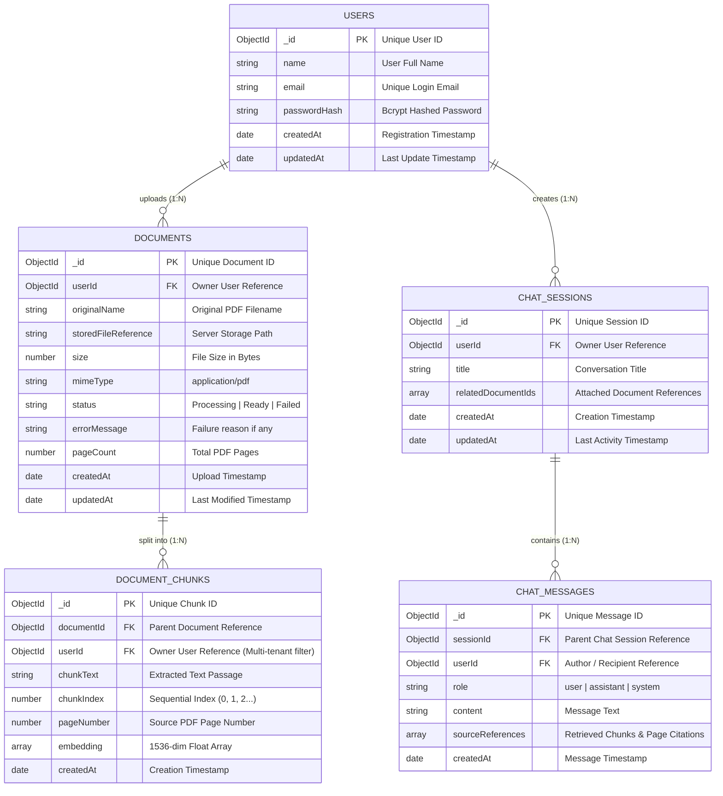

# 04 - Database Design

## 1. Database Overview
The application uses **MongoDB** as its primary document store, alongside **MongoDB Atlas Vector Search** for storing and querying high-dimensional vector embeddings.

### Why MongoDB?
- **Document-Oriented:** Document chunking and chat histories are naturally hierarchical and map cleanly to JSON/BSON documents.
- **Unified Vector Engine:** Storing vector embeddings directly inside MongoDB Atlas eliminates the complexity, maintenance overhead, and cost of running a separate standalone vector database (like Pinecone or Milvus).
- **Type Safety & Validation:** Mongoose provides strict schema validation, relationship referencing, and middleware hooks in Node.js.

---

## 2. Core Concepts in Simple English

1. **Table (Collection in MongoDB):**  
   Think of a collection as a folder or spreadsheet tab for a specific kind of data (e.g., a collection for `Users`, a collection for `Documents`).
2. **Column / Field:**  
   The individual pieces of information stored inside an entry (e.g., `email`, `file_name`, `created_date`).
3. **Primary Key (`_id`):**  
   A guaranteed unique identifier assigned to every single record, like a passport or national ID number.
4. **Foreign Key (Reference / Link):**  
   A field that points to the `_id` of another collection to establish a connection (e.g., `userId` in the `Documents` collection links the file to the user who uploaded it).
5. **Vector Embedding:**  
   An array of floating-point numbers (1536 dimensions) generated by OpenAI that represents the mathematical *meaning* of a text chunk. Similar meanings have vectors that point in similar directions in vector space.

---

## 3. Entity-Relationship (ER) Diagram



### Relationship Summary:
- **User $\rightarrow$ Documents (1:N):** One user can upload multiple PDFs.
- **Document $\rightarrow$ DocumentChunks (1:N):** One PDF yields many text chunks and vectors.
- **User $\rightarrow$ ChatSessions (1:N):** One user can create multiple chat threads.
- **ChatSession $\rightarrow$ ChatMessages (1:N):** One session contains many conversation turns.
- **ChatMessages $\rightarrow$ Source References:** Embedded array containing document names, page numbers, and text snippets used by the AI to answer.

---

## 4. Detailed Collection Schemas

### 4.1 `Users` Collection
Stores user account credentials and profile metadata.

| Field Name | Type | Constraints / Validation | Description |
| :--- | :--- | :--- | :--- |
| `_id` | ObjectId | Auto-generated Primary Key | Unique user identifier |
| `name` | String | Required, trimmed, max 60 chars | User's full name |
| `email` | String | Required, unique, lowercase, trimmed | User's unique login email |
| `passwordHash` | String | Required | Salted bcrypt hash of user's password |
| `createdAt` | Date | Default `Date.now` | Account creation timestamp |
| `updatedAt` | Date | Default `Date.now` | Profile last update timestamp |

**Indexes:**
- Unique index on `email`: `{ email: 1 }, { unique: true }`

---

### 4.2 `Documents` Collection
Stores uploaded PDF file metadata and processing state.

| Field Name | Type | Constraints / Validation | Description |
| :--- | :--- | :--- | :--- |
| `_id` | ObjectId | Auto-generated Primary Key | Unique document identifier |
| `userId` | ObjectId | Required, ref: `'User'` | Reference to document owner |
| `originalName` | String | Required, trimmed | Original filename of the uploaded PDF |
| `storedFileReference`| String | Required | Secure local storage path or file reference |
| `size` | Number | Required, in bytes | File size on disk |
| `mimeType` | String | Required, enum: `['application/pdf']`| MIME type validation |
| `status` | String | Required, enum: `['Processing', 'Ready', 'Failed']`, default: `'Processing'` | Ingestion pipeline state |
| `errorMessage` | String | Optional, default null | Human-readable explanation if status is `Failed` |
| `pageCount` | Number | Optional | Total number of pages extracted |
| `createdAt` | Date | Default `Date.now` | Upload timestamp |
| `updatedAt` | Date | Default `Date.now` | Last status update timestamp |

**Indexes:**
- Compound index on `userId` and `createdAt`: `{ userId: 1, createdAt: -1 }` (for fast dashboard listing).

---

### 4.3 `DocumentChunks` Collection
Stores chunked text segments alongside their high-dimensional vector embeddings for RAG retrieval.

| Field Name | Type | Constraints / Validation | Description |
| :--- | :--- | :--- | :--- |
| `_id` | ObjectId | Auto-generated Primary Key | Unique chunk identifier |
| `documentId` | ObjectId | Required, ref: `'Document'` | Parent document reference |
| `userId` | ObjectId | Required, ref: `'User'` | Owner reference for multi-tenant security filtering |
| `chunkText` | String | Required | The raw text slice from the PDF |
| `chunkIndex` | Number | Required | Sequential index (0, 1, 2, ...) within the document |
| `pageNumber` | Number | Optional | The PDF page where this text originated |
| `embedding` | Array of Number | Required, length: 1536 | Vector output from `text-embedding-3-small` |
| `createdAt` | Date | Default `Date.now` | Ingestion timestamp |

**Indexes:**
- Regular index on `{ documentId: 1 }` (for fast cascading deletion when parent document is deleted).
- Compound index on `{ userId: 1, documentId: 1 }`.
- **Atlas Vector Search Index (`vector_index`):**
  - Path: `embedding`
  - Dimensions: `1536`
  - Similarity Metric: `cosine`
  - Filter Field: `userId` (enforces strict multi-tenant authorization at vector query time).

---

### 4.4 `ChatSessions` Collection
Maintains multi-turn conversation threads.

| Field Name | Type | Constraints / Validation | Description |
| :--- | :--- | :--- | :--- |
| `_id` | ObjectId | Auto-generated Primary Key | Unique session identifier |
| `userId` | ObjectId | Required, ref: `'User'` | Conversation owner reference |
| `title` | String | Required, default `'New Conversation'` | Human-readable chat title |
| `relatedDocumentIds`| Array of ObjectId | Ref: `'Document'` | Documents attached to this chat thread |
| `createdAt` | Date | Default `Date.now` | Session start timestamp |
| `updatedAt` | Date | Default `Date.now` | Last message timestamp |

**Indexes:**
- Compound index on `{ userId: 1, updatedAt: -1 }` (for displaying recent chats first).

---

### 4.5 `ChatMessages` Collection
Stores individual turns within a chat session.

| Field Name | Type | Constraints / Validation | Description |
| :--- | :--- | :--- | :--- |
| `_id` | ObjectId | Auto-generated Primary Key | Unique message identifier |
| `sessionId` | ObjectId | Required, ref: `'ChatSession'` | Parent chat session reference |
| `userId` | ObjectId | Required, ref: `'User'` | Message author / recipient reference |
| `role` | String | Required, enum: `['user', 'assistant', 'system']` | Author role in conversation |
| `content` | String | Required | The actual text of the question or response |
| `sourceReferences` | Array of Subdocuments | Optional | Chunks/pages used to generate assistant response |
| `createdAt` | Date | Default `Date.now` | Message timestamp |

#### Subdocument Schema: `sourceReferences`
```json
[
  {
    "documentId": "64f1a2b3c4d5e6f7a8b9c0d1",
    "documentName": "Financial_Report_Q3.pdf",
    "pageNumber": 14,
    "chunkSnippet": "Total net income grew by 18% year-over-year..."
  }
]
```

**Indexes:**
- Index on `{ sessionId: 1, createdAt: 1 }` (for rapid chronological message loading).

---

## 5. Practical Walkthrough: How Data is Stored in Practice

Here is a step-by-step example showing how information flows between these 5 collections:

### Step 1: User Uploads a PDF
1. Alice uploads `Rental_Agreement.pdf`.
2. A single record is created in **`Documents`**:
   - `_id`: `doc_101`
   - `userId`: `user_alice`
   - `originalName`: `"Rental_Agreement.pdf"`
   - `status`: `"Processing"`

### Step 2: Ingestion & Vector Storage
1. The server reads the PDF buffer and slices the text into chunks.
2. For each chunk, OpenAI generates a 1536-dimensional embedding.
3. Chunks are stored in **`DocumentChunks`**:
   - `_id`: `chunk_001`
   - `documentId`: `doc_101`
   - `userId`: `user_alice`
   - `pageNumber`: `3`
   - `chunkText`: `"The tenant must pay rent on the 1st of every month..."`
   - `embedding`: `[0.0142, -0.0231, ... 1536 floats]`
4. Once all chunks are saved, the server updates `doc_101` in **`Documents`** to `status: "Ready"`.

### Step 3: Starting a Chat Thread
1. Alice starts a chat session about this document. A record is inserted into **`ChatSessions`**:
   - `_id`: `session_500`
   - `userId`: `user_alice`
   - `title`: `"Rent Due Dates"`
   - `relatedDocumentIds`: `["doc_101"]`

### Step 4: Asking a Question & Saving Citations
1. Alice asks: *"When is rent due?"*
2. Alice's question is saved in **`ChatMessages`**:
   - `sessionId`: `session_500`, `role`: `"user"`, `content`: `"When is rent due?"`
3. The server runs `$vectorSearch`, finds `chunk_001` on Page 3, and sends it to OpenAI.
4. OpenAI responds: *"Rent is due on the 1st of every month."*
5. The AI reply is saved in **`ChatMessages`**:
   - `sessionId`: `session_500`
   - `role`: `"assistant"`
   - `content`: `"Rent is due on the 1st of every month."`
   - `sourceReferences`: `[{ documentId: "doc_101", documentName: "Rental_Agreement.pdf", pageNumber: 3 }]`

---

## 6. Multi-Tenant Security & Cascading Delete Rules

### 6.1 Strict Query Scoping
To prevent unauthorized access across users:
- Every query on `Documents`, `DocumentChunks`, `ChatSessions`, and `ChatMessages` **must** include `{ userId: req.user._id }`.
- Even when querying by document ID, always scope by user ID:
  ```javascript
  const doc = await Document.findOne({ _id: documentId, userId: req.user._id });
  ```

### 6.2 Cascading Document Deletion (FR-18)
When a user deletes a document:
1. Delete the physical PDF file from server storage.
2. Delete the record from the `Documents` collection.
3. Delete all associated chunks from `DocumentChunks` where `documentId` matches.
4. Remove `documentId` from `relatedDocumentIds` in `ChatSessions`.
